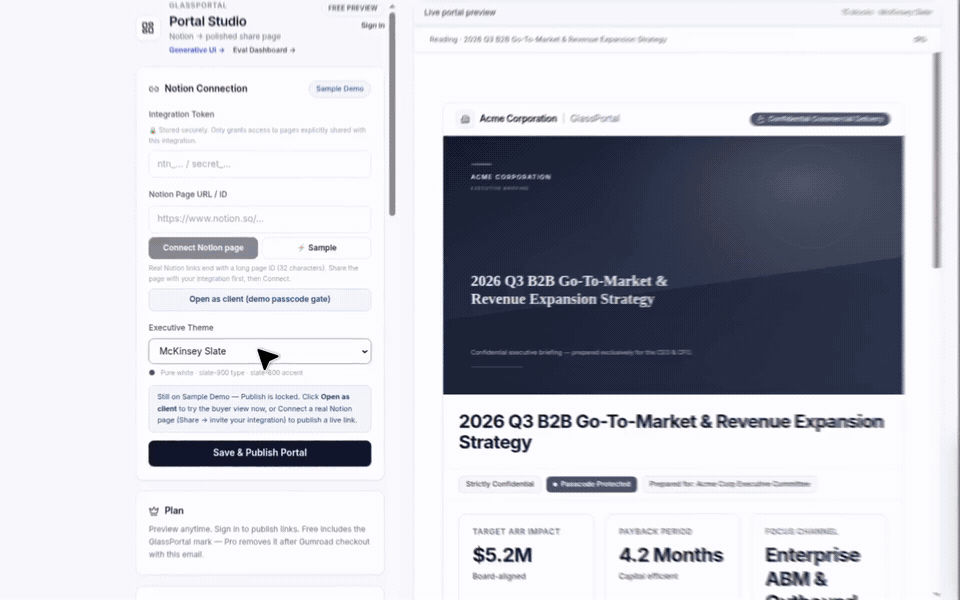
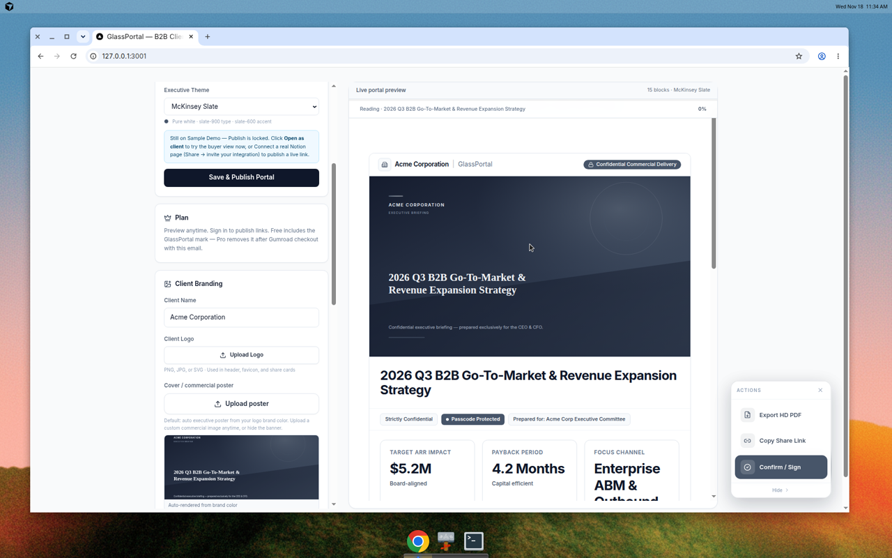
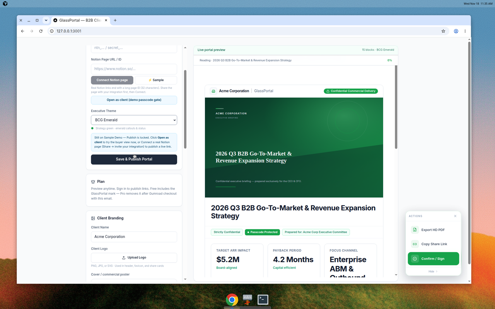
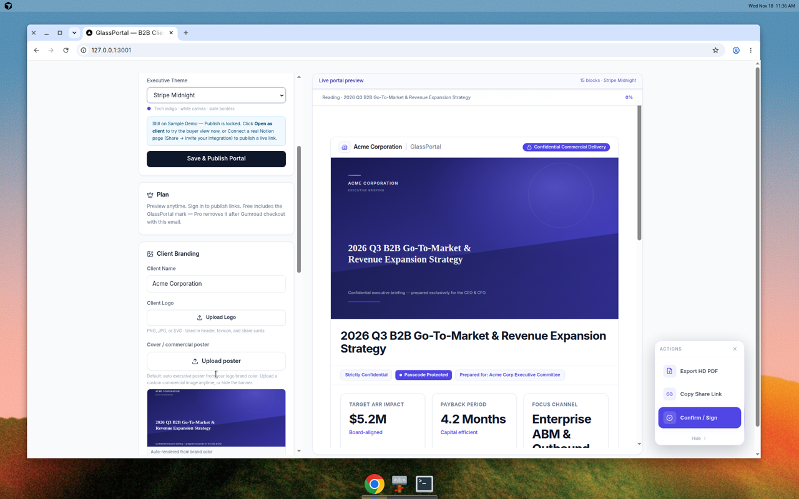

# Studio — Auto Brand Commercial Cover

Sample preview no longer shows a flat black banner. The cover is an **executive commercial poster** auto-rendered from the client **brand color** (logo sampling / Executive Theme). Users can still upload a custom poster or hide the banner.

## Demo GIF



[MP4 version](./demos/auto-brand-cover-theme-switch.mp4)

## What the demo shows

1. **McKinsey Slate** — navy commercial poster with Acme + title  
2. Switch theme → **BCG Emerald** — cover retints green instantly  
3. Switch theme → **Stripe Midnight** — cover retints purple  
4. Branding panel thumbnail: *Auto-rendered from brand color*  
5. **Hide cover** / **Show cover**

## Stills

| Slate | Emerald | Midnight |
| --- | --- | --- |
|  |  |  |

## How to try locally

```bash
npm run build && npx next start -H 127.0.0.1 -p 3001
# open http://127.0.0.1:3001/ → Sample → change Executive Theme
```
